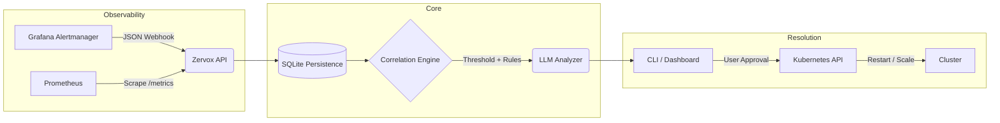

# Zervox: AIOps Incident Copilot 🚀

[](https://www.rust-lang.org)
[](https://opensource.org/licenses/MIT)
[]()

**Observe. Analyze. Recommend. Execute.**

Zervox is a next-generation AIOps platform built in Rust. It bridges the gap between raw observability data and safe, intelligent incident resolution. Instead of waking up engineers with contextless alerts, Zervox ingests metrics and logs, correlates anomalies, explains root causes via LLM, and suggests human-approved Kubernetes execution steps.

---

## 📖 Table of Contents
- [Why Zervox?](#why-zervox)
- [Architecture](#architecture)
- [How it Works in Practice](#how-it-works-in-practice)
- [Quick Start](#quick-start)
- [Roadmap & Production Status](#roadmap--production-status)
- [Contributing](#contributing)

---

## 🎯 Why Zervox?

Modern microservices generate too much noise. When an incident occurs, engineers spend the first 20 minutes just trying to correlate Prometheus metric spikes with Kubernetes error logs. 

Zervox acts as your **SRE Copilot**:
1. **Never drops an alert:** Non-blocking async ingestion queues.
2. **Understands context:** GPT-4o LLM integration reads the logs and metrics together.
3. **Takes safe action:** Recommends fixes and executes them via the Kubernetes API only when authorized.

---

## 🏗️ Architecture

Zervox is designed as a modular pipeline. Data flows from left to right, ending in safe execution.



### The Four Pillars:
1. **Ingestion Layer:** Accepts payloads from Grafana webhooks and native Prometheus scrapers.
2. **State & Persistence:** Uses `rusqlite` to safely persist incident payloads to `zervox_incidents.db`.
3. **Analysis Engine:** Combines heuristic threshold matching with LLM-powered natural language analysis.
4. **Execution Layer:** Uses `kube-rs` to execute authenticated deployment rollouts and fixes safely.

---

## 🔍 How it Works in Practice

Imagine your `api-gateway` starts failing.

1. **Grafana** detects a P99 latency spike and fires a webhook to Zervox.
2. **Zervox** parses the webhook, pulls the recent error logs for `api-gateway`, and correlates the data.
3. **The LLM** summarizes: *"The api-gateway is experiencing high latency due to a memory leak in the auth middleware (OOMKilled)."*
4. **Zervox CLI** prompts you:
   ```text
   [FIRING] HighAPILatency (api-gateway critical)
   Incident Summary: The api-gateway is experiencing high latency due to a memory leak.
   
   Recommended Actions:
   1. [High Confidence] Restart API Service
   2. [Medium Confidence] Scale Up Replicas
   
   Select an action to execute: 1
   ```
5. You type `1`. Zervox natively contacts the Kubernetes API and restarts the deployment. Incident resolved.

---

## 🚀 Quick Start

### 1. Build and Run the Server

Ensure you have Rust installed, then build the binary:

```bash
cargo build --release
./target/release/zervox server --port 3000
```

### 2. Configure Grafana Alertmanager

Point your existing Grafana or Alertmanager webhooks to your Zervox instance:
```text
POST http://<zervox-host>:3000/api/grafana_webhook
```

### 3. Simulate an Incident

Want to see it in action without breaking your production cluster? Run the included simulation script:
```bash
./scripts/simulate_incident.sh
```

### 4. Interactive CLI

Analyze stored incidents and authorize fixes directly from your terminal:
```bash
zervox analyze
```

---

## 🚧 Roadmap & Production Status

Zervox is currently in an **Advanced Prototype** stage. It successfully proves the architectural flow from ingestion to Kubernetes execution. However, it is not yet suitable for mission-critical enterprise environments.

**Requirements for V1.0 (Production-Ready):**
- [ ] **Distributed Database:** Replace SQLite with PostgreSQL for concurrent access.
- [ ] **Durable Event Queue:** Replace `tokio::spawn` with Redis, NATS, or Kafka for guaranteed job execution.
- [ ] **Security & RBAC:** Implement JWT authentication and a strict policy engine for Kubernetes execution (e.g., allow restarts, deny deletions).
- [ ] **Native OTLP:** Add OpenTelemetry native ingestion for traces.

---

## 🤝 Contributing

We welcome contributions! If you want to help transition Zervox from an advanced prototype to a production powerhouse, please open an Issue to discuss architecture before submitting a Pull Request.

1. Fork the Project
2. Create your Feature Branch (`git checkout -b feature/AmazingFeature`)
3. Commit your Changes (`git commit -m 'Add some AmazingFeature'`)
4. Push to the Branch (`git push origin feature/AmazingFeature`)
5. Open a Pull Request

---

## 📜 License

Distributed under the MIT License. See `LICENSE` for more information.

*Built with ❤️ in Rust, using Axum, Tokio, kube-rs, and rusqlite.*
